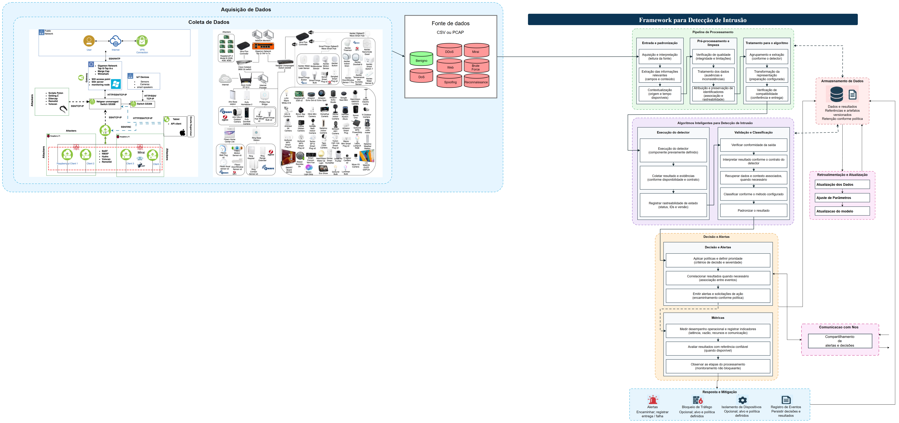

# Diagrama do framework

O diagrama apresenta a arquitetura do framework de detecção de intrusões na borda, da aquisição de dados à decisão e à emissão de alertas. Também mostra os componentes de armazenamento, retroalimentação, comunicação entre nós e resposta e mitigação.

[Abrir a imagem em alta resolução](figuras/framework-final.png) · [Baixar o arquivo editável para abrir no diagrams.net](figuras/framework-final.drawio)

A avaliação experimental utilizou capturas PCAP do CICIoT2023. A captura ao vivo, a operação entre máquinas distintas e a mitigação ativa são extensões previstas na arquitetura.

As imagens do laboratório incorporadas no bloco de aquisição de dados têm como fonte o Canadian Institute for Cybersecurity e o artigo de [Neto et al. (2023)](https://doi.org/10.3390/s23135941), publicado sob licença [CC BY 4.0](https://creativecommons.org/licenses/by/4.0/).
